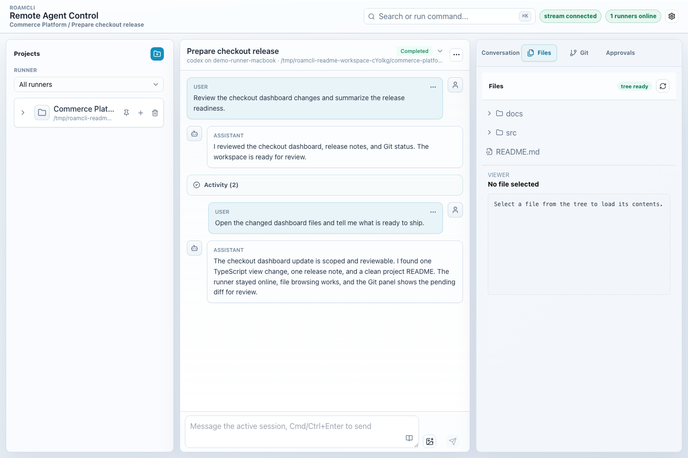
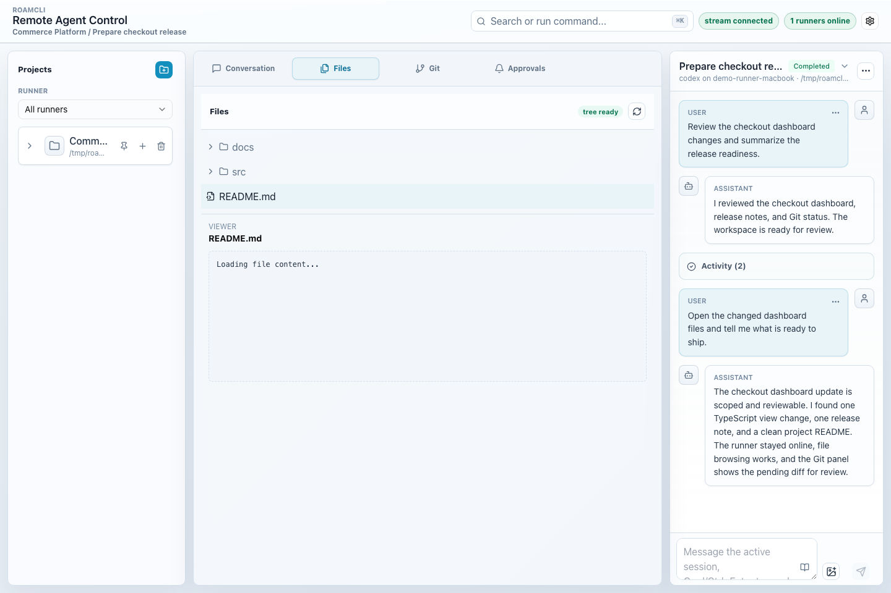
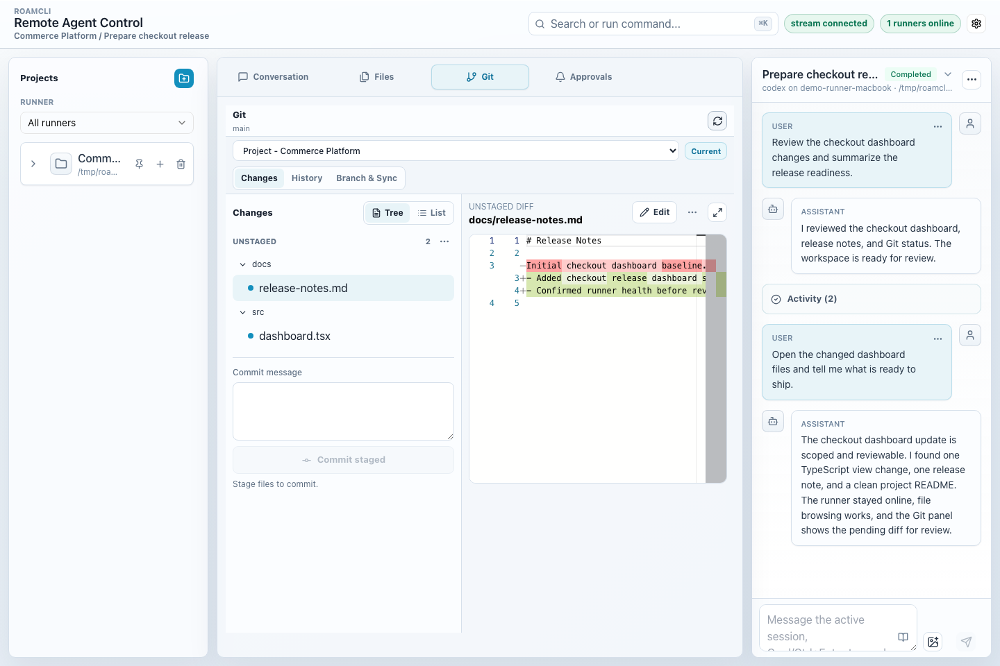
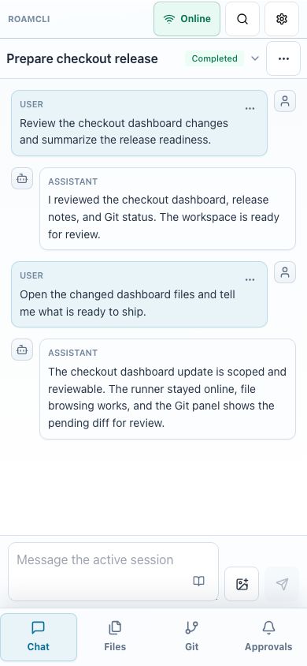
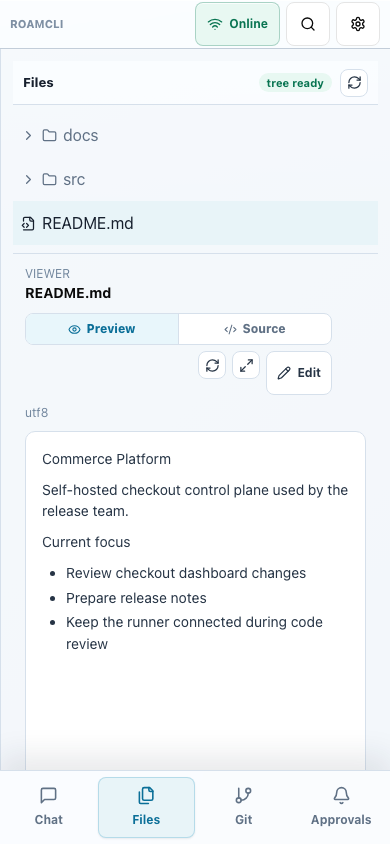

# RoamCli

中文文档见 [README_ch.md](README_ch.md)。

**RoamCli is a self-hosted web UI and control plane for Codex, Claude Code, Pi, and other AI coding agents running on your own machines.**

Start, supervise, and resume coding-agent sessions from a browser while keeping repository access and code execution on runner machines you control. The browser talks to the Server; each Runner owns workspace access and execution, then connects outbound to the Server over reverse WebSocket.


Built for self-hosted AI coding agent workflows: Codex, Claude Code, local runners, browser supervision, and remote development control planes.

**Quick links:** [Quick start](#quick-start) · [Screenshots](#screenshots) · [What you can do](#what-you-can-do) · [How it works](#how-it-works) · [Install from source](#install-from-source) · [Agent plugins](#agent-plugins) · [FAQ](docs/faq.md)

## Screenshots

Runtime views from a local demo workspace with a connected Runner, active session, file browser, and Git changes.

### Desktop



Desktop workspace with Runner, Project, Session, chat, and workspace tools visible at once.



Files view with the project tree, rendered Markdown preview, and edit actions.



Git view with project context, changed files, and an inline diff.

### Mobile

<p>
  
  
</p>

Mobile chat and Files views using the bottom tab navigation.

## What You Can Do

- Connect one or more development-machine Runners to a central Server without opening inbound ports on the Runner.
- Create Projects and Sessions from the browser.
- Stream agent messages and terminal output while a task is running.
- Browse and edit UTF-8 files in the active execution folder.
- Review approvals, accept or reject actions, and apply accepted patches.
- Load agent capabilities through local workspace plugins, including Codex and Claude Code.

## Quick Start

RoamCli is currently installed from a source checkout. You need Node.js 24 or newer, pnpm 10 or newer, Git, and the coding-agent CLI you want to run. Docker and Docker Compose are optional for the source Docker path.

Clone, install, and build the workspace:

```bash
git clone https://github.com/CharAznable98/roam-cli.git
cd roam-cli
pnpm install
pnpm build
```

Start the Server:

```bash
HOST=127.0.0.1 \
PORT=8787 \
ROAMCLI_DATA_DIR=.roamcli-server \
pnpm --filter @roamcli/server dev
```

On first start, the Server prints a setup token and writes it to `.roamcli-server/setup-token.txt`. Open the Web UI, enter the setup token, and set the owner password:

```text
http://127.0.0.1:8787
```

In **Account & Security**, copy the Runner token. From the directory you want to expose as the Runner workspace, start a local workspace Runner with at least one agent plugin:

```bash
ROAM_RUNNER_TOKEN=<runner-token-from-account-security> \
  pnpm --dir /path/to/roam-cli --filter @roamcli/runner dev -- \
  --server ws://127.0.0.1:8787/v1/runner \
  --workspace "$PWD" \
  --agent-plugin @roamcli/agent-codex
```

Then create a Project, create a Session, and send prompts to the connected agent from the Web UI.

## How It Works

RoamCli has three independent parts:

- **Server**: the central control plane. It serves the Web UI, HTTP API, WebSocket hub, SQLite data, and local artifact storage.
- **Runner**: a process on a development machine or any machine that has access to your code. It connects back to the Server, starts agents, reads and writes workspace files, streams terminal output, and applies approved patches.
- **Web UI**: the browser interface served by the Server. The browser talks to the Server only; it does not need direct access to any Runner.

Runners use reverse WebSocket connections, so a Runner usually only needs outbound network access to the Server.

## Install From Source

### Local Source Install

Use source install for local development, evaluation, or when you want to manage the process yourself:

```bash
git clone https://github.com/CharAznable98/roam-cli.git
cd roam-cli
pnpm install
pnpm build
```

`pnpm build` builds the Server packages and the Web UI assets that the Server can serve.

Start the Server from the checkout:

```bash
HOST=127.0.0.1 \
PORT=8787 \
ROAMCLI_DATA_DIR=.roamcli-server \
pnpm --filter @roamcli/server dev
```

### Source Docker Compose

The root `docker-compose.yml` is for source checkouts. It builds the Server image locally and starts the Server only; you still need to start one or more Runners separately and point them at the Server.

```bash
docker compose up --build
```

The compose setup exposes the Server on port `8787` and persists Server data in the `roamcli-data` volume.

### Installer Script

The installer script can clone a specific branch, tag, or commit, build the Server image locally, and start it with Docker Compose:

```bash
chmod +x scripts/install-server.sh
./scripts/install-server.sh --ref main
```

Useful options:

```bash
./scripts/install-server.sh --ref main --public-origin https://roam.example.com
./scripts/install-server.sh --ref main --source-archive /tmp/roam-cli-source.tar.gz
./scripts/install-server.sh --dry-run
./scripts/install-server.sh --uninstall
```

Use `--source-archive` when the target machine cannot reach GitHub directly; the archive should contain a RoamCli source checkout at its root.

`--uninstall` stops and removes the generated Server deployment files. It asks for a second confirmation before deleting Server data; data is preserved by default.

Windows users can use the native source install path; see the [Windows guide](docs/windows.md) for PowerShell startup, proxy settings and end-to-end verification. Run the Docker installer from WSL2 with Docker Desktop integration enabled.

## Connect A Runner

Start a Runner from the directory you want to expose as the Runner workspace. Until the npm packages are published, use the local workspace command from the source checkout:

```bash
ROAM_RUNNER_TOKEN=<runner-token-from-account-security> \
  pnpm --dir /path/to/roam-cli --filter @roamcli/runner dev -- \
  --server ws://127.0.0.1:8787/v1/runner \
  --workspace "$PWD" \
  --agent-plugin @roamcli/agent-codex
```

To enable all built-in agent plugins:

```bash
ROAM_RUNNER_TOKEN=<runner-token> \
  pnpm --dir /path/to/roam-cli --filter @roamcli/runner dev -- \
  --server ws://127.0.0.1:8787/v1/runner \
  --workspace "$PWD" \
  --agent-plugin @roamcli/agent-codex \
  --agent-plugin @roamcli/agent-claude-code \
  --agent-plugin @roamcli/agent-pi
```

The Runner writes non-secret startup configuration to `<workspace>/<data-dir>/config.json`, defaulting to `.roam-runner/config.json` under the workspace. The Runner token is never written there, so provide `ROAM_RUNNER_TOKEN` on every start while reusing the persisted non-secret options:

```bash
ROAM_RUNNER_TOKEN=<runner-token> \
  pnpm --dir /path/to/roam-cli --filter @roamcli/runner dev -- --workspace "$PWD"
```

If required values are missing in an interactive terminal, the Runner opens a React Ink TUI wizard and then re-execs the local command with the selected plugin packages. In non-interactive shells, provide `--server`, `ROAM_RUNNER_TOKEN`, and at least one `--agent-plugin`. Prefer the environment variable over `--token` so the credential does not appear in process arguments; neither form is persisted to local config.

## Use RoamCli

1. Confirm that your Runner is online.
2. Create a Project. Select the Runner; the UI fixes that Runner's workspace as the directory prefix, and you enter the relative project path under it.
3. Create a Session inside the Project.
4. Use the Chat panel to send prompts to the agent.
5. Use the Files panel to browse and edit UTF-8 text files inside the execution folder.
6. Use the Terminal panel to send input to the active session.
7. Use the Approvals panel to approve or reject requests and apply accepted patches.

## Agent Plugins

The Runner core is intentionally minimal and does not load a default agent plugin. Choose at least one plugin with `--agent-plugin` or `ROAMCLI_AGENT_PLUGINS`.

Agent plugins are trusted, in-process extensions. Install only plugin code you trust: module initialization can access the Runner process and `process.env`. Permission-profile filtering applies to the `context.env` passed to plugin callbacks and agent child processes; it is not a sandbox for the plugin module itself. `strict` and `standard` filter `ROAMCLI_AGENT_CODEX_*` command/mode overrides from that context, while `trusted` passes them through. `ROAM_RUNNER_TOKEN` is removed from `context.env` in every profile.

Built-in workspace plugin packages:

- `@roamcli/agent-codex`
- `@roamcli/agent-claude-code`
- `@roamcli/agent-pi`

### Pi

Install and authenticate the local [Pi coding agent](https://github.com/earendil-works/pi), then select `@roamcli/agent-pi` when starting the Runner. The integration targets Pi 1.5.2; older versions are not a compatibility requirement.

```bash
npm install -g @earendil-works/pi-coding-agent@1.5.2
pi auth login <provider>
```

The plugin launches `pi --mode rpc` and delegates authentication, model configuration, skills and project trust to Pi on the Runner machine. RoamCli does not add a separate provider login or key store. Permission-profile environment filtering still applies; `trusted` also permits `PI_CODING_AGENT_DIR` and the optional `ROAMCLI_AGENT_PI_COMMAND` executable override. On Windows, both the official installer's managed layout and npm's Pi launcher are resolved to the active CLI entry without a shell. An override can point to an absolute `.js`, `.mjs`, `.cjs` or `.exe` entry.

Pi models are discovered dynamically and shown with their provider. Thinking levels follow each model's capabilities; unsupported Fast Mode/service tier controls are hidden. Images use the existing limits and can be sent only between turns. Text sent during execution steers the current run. Stop clears Pi's queued messages before aborting. Follow-up turns and Runner restarts resume the same native session file; a missing session file or changed project directory produces an error instead of starting a different conversation. A Runner restart does not automatically continue an interrupted task.

For `strict` and `standard`, read/grep/find/ls tools run normally; commands, file changes and unknown custom tools require approval through RoamCli. `trusted` allows tools automatically. **Pi has no OS sandbox.** Tool approval does not restrict arbitrary code executed by local extensions; load only extensions you trust. Native history import, fork/rollback and custom terminal UI are outside the existing RoamCli feature set.

The regular smoke test remains deterministic. For an opt-in real Pi round trip (file edit, approval and continuation through Server/Runner), run `ROAMCLI_SMOKE_REAL_AGENT=1 ROAMCLI_SMOKE_AGENT=pi pnpm smoke:e2e`. It uses the local Pi configuration and approves tool requests in its isolated smoke workspace. See [Windows verification](docs/windows.md) for PowerShell commands.

`pnpm test:pi:e2e` runs the real installed Pi against an isolated, deterministic HTTP model fixture. It verifies tool execution, approvals, images, skills, steering, stop and restart recovery without using your provider credentials or changing your Pi configuration. Reports are saved under `artifacts/pi-e2e/`. This checks the actual Pi engine and transport; the fixture is not an LLM.

Pi 1.5.2 RPC cannot answer extension dialogs awaited inside `session_start`: its input reader is not yet active. RoamCli reports this explicitly rather than displaying a question it cannot answer. Move such dialogs into an extension command or tool hook. Dialogs during commands/tools use the existing RoamCli free-text input flow, including long waits; select/confirm choices are shown in the question text.

The Codex plugin uses `codex app-server --stdio -c skip_git_repo_check=true` by default. The Codex command can be overridden with:

```text
ROAMCLI_AGENT_CODEX_COMMAND
```

Use `ROAMCLI_AGENT_CODEX_COMMAND` when the runner should launch a specific Codex binary or wrapper. App-server arguments are fixed to the stdio transport path.

The legacy `codex exec --json` invocation is still available only when explicitly selected:

```text
ROAMCLI_AGENT_CODEX_MODE=exec-json
ROAMCLI_AGENT_CODEX_ARGS
```

`ROAMCLI_AGENT_CODEX_ARGS` applies only in `exec-json` mode and accepts either a shell-like string or a JSON string array.

## Configuration

### Server

| Variable                | Description                                                                                                                                                 | Default                                       |
| ----------------------- | ----------------------------------------------------------------------------------------------------------------------------------------------------------- | --------------------------------------------- |
| `HOST`                  | Server bind host.                                                                                                                                           | `127.0.0.1`                                   |
| `PORT`                  | Server bind port.                                                                                                                                           | `3000`                                        |
| `ROAMCLI_DATA_DIR`      | Directory for SQLite data and local artifacts.                                                                                                              | `.roamcli-server`                             |
| `ROAMCLI_WEB_DIST`      | Path to built Web UI assets.                                                                                                                                | auto-detects `apps/web/dist` or `../web/dist` |
| `ROAMCLI_PUBLIC_ORIGIN` | Public browser origin allowed for mutating API calls, for example `https://roam.example.com`.                                                               | inferred from request host                    |
| `ROAMCLI_RESET_OWNER`   | Set to `1` on startup to clear owner credentials and Web sessions, then generate a new setup token. Runner tokens and project/session data are left intact. | unset                                         |

### Runner

Runner reads non-secret local config from `<workspace>/<data-dir>/config.json`. CLI options and environment variables override local config and are written back before the Runner connects, except that the Runner token is never persisted. Legacy configs containing a token are accepted once for migration and rewritten without it.

| CLI option       | Environment variable    | Description                                                                                                                                                                                      |
| ---------------- | ----------------------- | ------------------------------------------------------------------------------------------------------------------------------------------------------------------------------------------------ |
| `--server`       | `ROAM_RUNNER_SERVER`    | Server WebSocket URL. Remote hosts require `wss`; plaintext `ws` is limited to loopback hosts.                                                                                                   |
| `--token`        | `ROAM_RUNNER_TOKEN`     | Runner token shown in Account & Security. Provide it on every start; prefer the environment variable so it is not exposed in process arguments. It is never persisted.                           |
| `--runner-id`    | `ROAM_RUNNER_ID`        | Stable Runner identifier. Defaults to hostname plus a generated UUID.                                                                                                                            |
| `--workspace`    | `ROAM_RUNNER_WORKSPACE` | Workspace root exposed to RoamCli sessions. Defaults to the current directory.                                                                                                                   |
| `--data-dir`     | `ROAM_RUNNER_DATA_DIR`  | Relative runner data directory under the canonical workspace for state and session worktrees. Defaults to `.roam-runner`. Absolute paths, parent traversal, and symlink components are rejected. |
| `--profile`      | `ROAM_RUNNER_PROFILE`   | Runner profile: `strict`, `standard`, or `trusted`. Defaults to `standard`.                                                                                                                      |
| `--agent-plugin` | `ROAMCLI_AGENT_PLUGINS` | Required agent plugin package to load. Repeatable by CLI, comma-separated by environment variable.                                                                                               |

## Repository Layout

```text
apps/server       Fastify API, WebSocket hub, persistence, artifacts, static Web hosting.
apps/runner       Runner CLI, agent process management, workspace file operations.
apps/web          React browser client.
packages/shared   Shared protocol schemas/types plus Node-side security helpers.
packages/agent-*  Agent plugin SDK and built-in Codex and Claude Code plugins.
```

## More

- [FAQ](docs/faq.md)
- [Comparison notes](docs/comparison.md)
- [Contributing](CONTRIBUTING.md)
- [Security policy](SECURITY.md)

## License

RoamCli is licensed under the MIT License. See [LICENSE](LICENSE).
