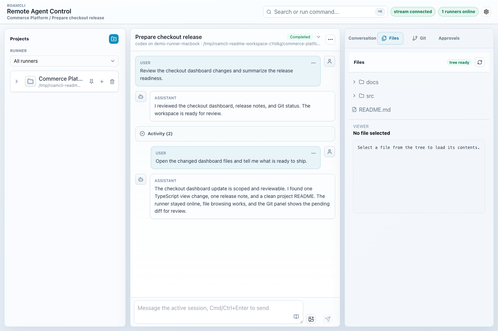
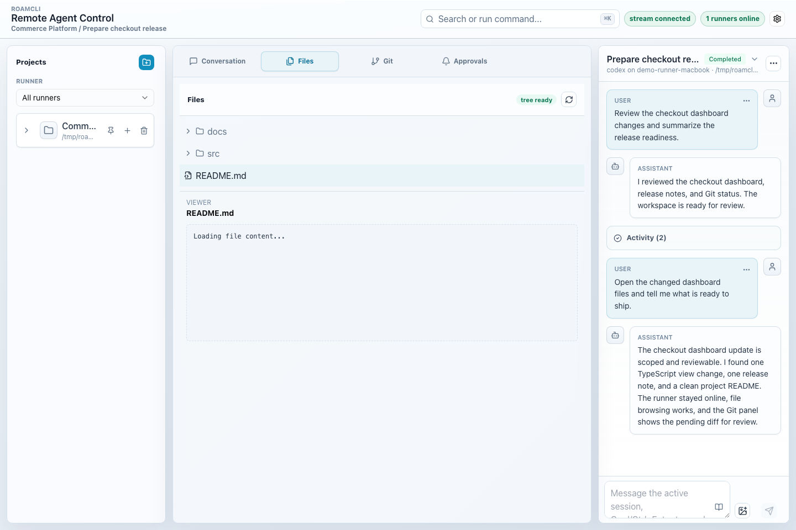
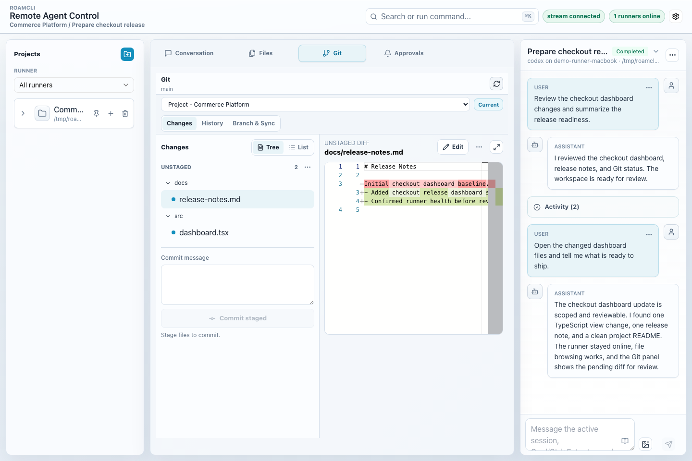
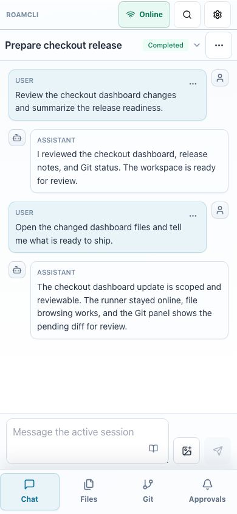
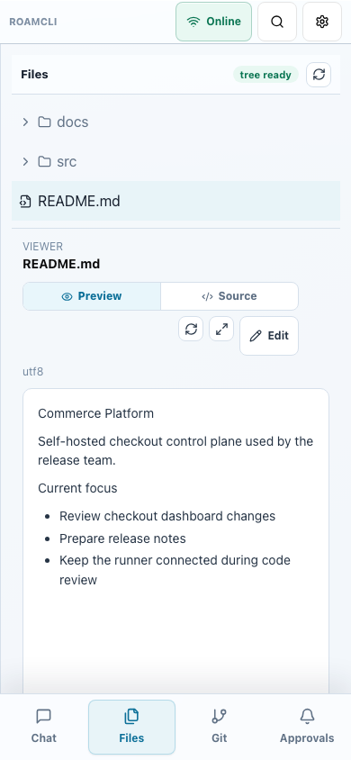

# RoamCli

English documentation is available in [README.md](README.md).

**RoamCli 是一个自托管 Web UI 和控制面，用来管理运行在自有机器上的 Codex、Claude Code 和其它 AI 编码 Agent。**

你可以在浏览器里启动、监督和恢复编码 Agent Session，同时把仓库访问和代码执行留在你控制的 Runner 机器上。浏览器只访问 Server；每个 Runner 负责自己的 workspace 访问和执行，并通过反向 WebSocket 主动连接 Server。


适合自托管 AI 编码 Agent 工作流：Codex、Claude Code、本地 Runner、浏览器监督和远程开发控制面。

**快速导航：** [快速开始](#快速开始) · [界面截图](#界面截图) · [可以做什么](#可以做什么) · [工作方式](#工作方式) · [源码安装](#源码安装) · [Agent 插件](#agent-插件) · [FAQ](docs/faq.md)

## 界面截图

以下截图来自本地 demo workspace，包含已连接的 Runner、活跃 Session、文件浏览和 Git 变更。

### 桌面端



桌面工作台同时展示 Runner、Project、Session、Chat 和工作区工具。



Files 视图展示项目文件树、Markdown 预览和编辑操作。



Git 视图展示项目上下文、变更文件和内联 diff。

### 移动端

<p>
  
  
</p>

移动端 Chat 和 Files 视图通过底部 Tab 切换。

## 可以做什么

- 把一个或多个开发机 Runner 连接到中心 Server，Runner 侧通常不需要开放入站端口。
- 在浏览器里创建 Project 和 Session。
- 在任务运行时查看 Agent 消息和终端输出。
- 浏览和编辑当前 execution folder 内的 UTF-8 文本文件。
- 处理审批，接受或拒绝操作，并应用已接受的 patch。
- 通过本地 workspace 插件加载 Agent 能力，包括 Codex 和 Claude Code。

## 快速开始

RoamCli 当前从源码 checkout 安装。你需要 Node.js 24 或更新版本、pnpm 10 或更新版本、Git，以及所选插件需要的编码 Agent CLI。Docker 和 Docker Compose 只在源码 Docker 路径中需要。

克隆、安装依赖并构建 workspace：

```bash
git clone https://github.com/CharAznable98/roam-cli.git
cd roam-cli
pnpm install
pnpm build
```

启动 Server：

```bash
HOST=127.0.0.1 \
PORT=8787 \
ROAMCLI_DATA_DIR=.roamcli-server \
pnpm --filter @roamcli/server dev
```

首次启动时 Server 会在日志中打印 setup token，并写入 `.roamcli-server/setup-token.txt`。打开 Web UI，输入 setup token 并设置 owner 密码：

```text
http://127.0.0.1:8787
```

在 **Account & Security** 中复制 Runner token。然后在你希望暴露为 Runner workspace 的目录下，至少带一个 Agent 插件启动本地 workspace Runner：

```bash
ROAM_RUNNER_TOKEN=<runner-token-from-account-security> \
  pnpm --dir /path/to/roam-cli --filter @roamcli/runner dev -- \
  --server ws://127.0.0.1:8787/v1/runner \
  --workspace "$PWD" \
  --agent-plugin @roamcli/agent-codex
```

之后在 Web UI 中创建 Project、创建 Session，并向已连接的 Agent 发送提示。

## 工作方式

RoamCli 由三个彼此独立的部分组成：

- **Server**：中心控制面，提供 Web UI、HTTP API、WebSocket hub、SQLite 数据和本地 artifact 存储。
- **Runner**：运行在开发机或任何能访问代码的机器上。Runner 会主动连接 Server，负责启动 Agent、读写 workspace 文件、转发终端输出，并应用已批准的 patch。
- **Web UI**：由 Server 提供的浏览器界面。浏览器只需要访问 Server，不需要直接访问 Runner。

Runner 使用反向 WebSocket 连接，因此运行 Runner 的机器通常只需要能出站访问 Server。

## 源码安装

### 本地源码安装

源码安装适合本地开发、试用，或你希望自行管理进程的场景：

```bash
git clone https://github.com/CharAznable98/roam-cli.git
cd roam-cli
pnpm install
pnpm build
```

`pnpm build` 会构建 Server 相关包和 Server 可托管的 Web UI 静态资源。

从 checkout 启动 Server：

```bash
HOST=127.0.0.1 \
PORT=8787 \
ROAMCLI_DATA_DIR=.roamcli-server \
pnpm --filter @roamcli/server dev
```

### 源码 Docker Compose

仓库根目录的 `docker-compose.yml` 面向源码 checkout。它会在本机构建 Server 镜像并启动 Server；你仍然需要单独启动一个或多个 Runner，并让它们连接到 Server。

```bash
docker compose up --build
```

compose 配置会把 Server 暴露在 `8787` 端口，并把 Server 数据持久化到 `roamcli-data` volume。

### 安装脚本

安装脚本可以克隆指定 branch、tag 或 commit，在本机构建 Server 镜像，并用 Docker Compose 启动：

```bash
chmod +x scripts/install-server.sh
./scripts/install-server.sh --ref main
```

常用选项：

```bash
./scripts/install-server.sh --ref main --public-origin https://roam.example.com
./scripts/install-server.sh --dry-run
./scripts/install-server.sh --uninstall
```

`--uninstall` 会停止并删除脚本生成的 Server 部署文件。删除 Server 数据前会二次确认；默认保留数据。

Windows 可直接使用本地源码安装；PowerShell 启动、代理配置和端到端验证步骤见 [Windows 指南](docs/windows.md)。Docker 安装脚本仍建议在启用 Docker Desktop 集成的 WSL2 中运行。

## 连接 Runner

在你希望暴露为 Runner workspace 的目录下启动 Runner。在 npm 包发布前，使用源码 checkout 的本地 workspace 命令：

```bash
ROAM_RUNNER_TOKEN=<runner-token-from-account-security> \
  pnpm --dir /path/to/roam-cli --filter @roamcli/runner dev -- \
  --server ws://127.0.0.1:8787/v1/runner \
  --workspace "$PWD" \
  --agent-plugin @roamcli/agent-codex
```

同时启用两个内置 Agent 插件：

```bash
ROAM_RUNNER_TOKEN=<runner-token> \
  pnpm --dir /path/to/roam-cli --filter @roamcli/runner dev -- \
  --server ws://127.0.0.1:8787/v1/runner \
  --workspace "$PWD" \
  --agent-plugin @roamcli/agent-codex \
  --agent-plugin @roamcli/agent-claude-code
```

Runner 会把非敏感启动配置写入 `<workspace>/<data-dir>/config.json`，默认是 workspace 下的 `.roam-runner/config.json`。Runner token 永远不会写入配置，因此每次启动都要提供 `ROAM_RUNNER_TOKEN`，其他非敏感参数可以复用：

```bash
ROAM_RUNNER_TOKEN=<runner-token> \
  pnpm --dir /path/to/roam-cli --filter @roamcli/runner dev -- --workspace "$PWD"
```

如果交互式终端里缺少必填参数，Runner 会进入 React Ink TUI 向导，并在收集完成后自动 re-exec 本地命令。非交互式环境必须提供 `--server`、`ROAM_RUNNER_TOKEN` 和至少一个 `--agent-plugin`。优先使用环境变量，避免 token 出现在进程参数中；两种 token 输入方式都不会写入本地配置。

## 使用 RoamCli

1. 确认 Runner 已在线。
2. 创建 Project，选择 Runner；界面会把该 Runner 的 workspace 固定为目录前缀，你只需要填写其下的相对项目路径。
3. 在 Project 下创建 Session。
4. 在 Chat 面板向 Agent 发送提示。
5. 在 Files 面板浏览和编辑 execution folder 内的 UTF-8 文本文件。
6. 在 Terminal 面板向当前 Session 发送输入。
7. 在 Approvals 面板处理批准或拒绝请求，并应用已接受的 patch。

## Agent 插件

Runner 核心保持极简，不会默认加载任何 Agent 插件。你必须通过 `--agent-plugin` 或 `ROAMCLI_AGENT_PLUGINS` 选择至少一个插件。

Agent 插件是受信任的进程内扩展，只应安装你信任的插件代码：模块初始化阶段可以访问 Runner 进程及 `process.env`。权限 profile 的环境过滤只作用于传给插件回调和 Agent 子进程的 `context.env`，并不是插件模块的隔离沙箱。`strict` 和 `standard` 会从该上下文中过滤 `ROAMCLI_AGENT_CODEX_*` 命令/模式覆盖变量，`trusted` 则会传入这些变量；所有 profile 都会移除 `ROAM_RUNNER_TOKEN`。

内置 workspace 插件包：

- `@roamcli/agent-codex`
- `@roamcli/agent-claude-code`

Codex 插件默认使用 `codex app-server --stdio -c skip_git_repo_check=true`。Codex 命令可以通过以下环境变量覆盖：

```text
ROAMCLI_AGENT_CODEX_COMMAND
```

当 Runner 需要启动指定 Codex 二进制或包装脚本时使用 `ROAMCLI_AGENT_CODEX_COMMAND`。App-server 参数固定为 stdio transport 路径。

旧的 `codex exec --json` 调用方式只在显式选择后可用：

```text
ROAMCLI_AGENT_CODEX_MODE=exec-json
ROAMCLI_AGENT_CODEX_ARGS
```

`ROAMCLI_AGENT_CODEX_ARGS` 只在 `exec-json` 模式生效，支持类 shell 字符串，也支持 JSON 字符串数组。

## 配置

### Server

| 变量                    | 说明                                                                                                               | 默认值                                    |
| ----------------------- | ------------------------------------------------------------------------------------------------------------------ | ----------------------------------------- |
| `HOST`                  | Server 绑定地址。                                                                                                  | `127.0.0.1`                               |
| `PORT`                  | Server 绑定端口。                                                                                                  | `3000`                                    |
| `ROAMCLI_DATA_DIR`      | SQLite 数据和本地 artifacts 目录。                                                                                 | `.roamcli-server`                         |
| `ROAMCLI_WEB_DIST`      | 构建后的 Web UI 资源路径。                                                                                         | 自动查找 `apps/web/dist` 或 `../web/dist` |
| `ROAMCLI_PUBLIC_ORIGIN` | 允许执行写操作的浏览器公开 origin，例如 `https://roam.example.com`。                                               | 根据请求 host 推断                        |
| `ROAMCLI_RESET_OWNER`   | 启动时设为 `1` 会清空 owner 凭据和 Web session，并生成新的 setup token。Runner token 和项目/session 数据保持不变。 | 未设置                                    |

### Runner

Runner 会从 `<workspace>/<data-dir>/config.json` 读取非敏感本地配置。CLI 参数和环境变量会覆盖本地配置，并在 Runner 连接前写回，但 Runner token 永远不会持久化。包含 token 的旧配置可读取一次用于迁移，随后会被改写并移除 token。

| CLI 参数         | 环境变量                | 说明                                                                                                                                        |
| ---------------- | ----------------------- | ------------------------------------------------------------------------------------------------------------------------------------------- |
| `--server`       | `ROAM_RUNNER_SERVER`    | Server WebSocket URL。`http` 和 `https` 会转换为 `ws` 和 `wss`。                                                                            |
| `--token`        | `ROAM_RUNNER_TOKEN`     | Account & Security 中展示的 Runner token。每次启动都要提供；优先使用环境变量，token 永远不会持久化。                                        |
| `--runner-id`    | `ROAM_RUNNER_ID`        | 稳定 Runner 标识。默认是 hostname 加生成的 UUID。                                                                                           |
| `--workspace`    | `ROAM_RUNNER_WORKSPACE` | 暴露给 RoamCli Session 的 workspace 根目录。默认是当前目录。                                                                                |
| `--data-dir`     | `ROAM_RUNNER_DATA_DIR`  | canonical workspace 下的相对 Runner 数据目录，用于状态和 session worktree。默认 `.roam-runner`，拒绝绝对路径、父级跳转和 symlink 路径组件。 |
| `--profile`      | `ROAM_RUNNER_PROFILE`   | Runner profile：`strict`、`standard` 或 `trusted`。默认是 `standard`。                                                                      |
| `--agent-plugin` | `ROAMCLI_AGENT_PLUGINS` | 必填的 Agent 插件包。CLI 可重复传入，环境变量用逗号分隔。                                                                                   |

## 仓库结构

```text
apps/server       Fastify API、WebSocket hub、持久化、artifacts、静态 Web 托管。
apps/runner       Runner CLI、Agent 进程管理、workspace 文件操作。
apps/web          React 浏览器客户端。
packages/shared   共享协议 schema/类型，以及 Node 侧安全辅助函数。
packages/agent-*  Agent 插件 SDK 和内置 Codex、Claude Code 插件。
```

## 更多

- [FAQ](docs/faq.md)
- [对比说明](docs/comparison.md)
- [贡献指南](CONTRIBUTING.md)
- [安全策略](SECURITY.md)

## 许可证

RoamCli 使用 MIT License。见 [LICENSE](LICENSE)。
